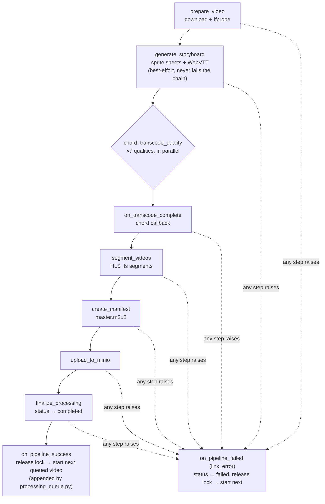

# 06 - Video Processing Pipeline

The raw video is uploaded. Now begins the most complex and CPU-intensive part of the entire system: the background processing pipeline. This document walks through every stage - what it does, why it's designed that way, and what can go wrong.

---

## Why a Background Pipeline?

Transcoding a one-hour video to seven quality levels takes minutes of CPU time, even on powerful hardware. You can't do that in an HTTP request - the connection would time out, the user's browser would give up, and you'd have no way to report progress.

The solution: as soon as the upload finishes, the API enqueues a job and returns immediately. A separate Celery worker process picks up the job and does the heavy lifting. The frontend polls a status endpoint every 3 seconds to show progress.

Celery was chosen for this because:
- It runs in a completely separate process (no blocking the API)
- It supports complex workflow primitives (run tasks in parallel, then run a callback when all complete)
- It handles retries automatically
- It has Flower, a built-in dashboard at http://localhost:5555

---

## The Workflow

Defined in `backend/app/tasks/workflows.py`. The full pipeline is a Celery chain:

```python
workflow = chain(
    prepare_video.s(video_id),
    generate_storyboard.s(),
    chord(
        group(
            # transcode_quality.s("2160p"),  # 4K - commented out, testing takes too long
            transcode_quality.s("1440p"),
            transcode_quality.s("1080p"),
            transcode_quality.s("720p"),
            transcode_quality.s("480p"),
            transcode_quality.s("360p"),
            transcode_quality.s("240p"),
            transcode_quality.s("144p"),
        ),
        on_transcode_complete.s()
    ),
    segment_videos.s(),
    create_manifest.s(),
    upload_to_minio.s(),
    finalize_processing.s()
)
```

This is sequential at the top level - each stage runs after the previous one completes - except for the transcoding step, which runs all seven quality levels in parallel simultaneously (via `chord` + `group`). Note that transcoding is now a single **parameterized** task, `transcode_quality`, invoked once per quality level with a string argument (`"1440p"`, `"1080p"`, ...) - earlier revisions of this pipeline had seven separate task functions (`transcode_1440p`, `transcode_1080p`, etc.); they were consolidated into one task. 4K (2160p) transcoding is commented out to speed up local development.

`create_video_processing_workflow()` only *builds* this chain - nothing dispatches it directly. The processing queue (`backend/app/tasks/processing_queue.py`, see [Multiple Videos: One Pipeline at a Time](#multiple-videos-one-pipeline-at-a-time) below) appends one more step, `on_pipeline_success`, after `finalize_processing`, attaches `on_pipeline_failed` as the chain's `link_error`, and only then calls `apply_async()`.



Let's walk through each stage.

---

## Multiple Videos: One Pipeline at a Time

Production runs the Celery worker with `--concurrency=1` (`infra/docker-compose.yml`), a deliberate choice, since the box is a single 2-vCPU, ~4 GiB droplet and FFmpeg is memory-hungry. That means exactly one task, from the entire system, executes at any instant. Celery doesn't know or care which video a task belongs to. Every task from every video's chain lands in the same default broker queue.

Left alone, that causes a specific problem: each video's transcode chord fires all 7 `transcode_quality` tasks into that shared queue as soon as its (fast) `prepare_video`/`generate_storyboard` steps finish. Upload several videos close together and all of their 7-task batches land in the queue around the same time. A short video's remaining stages (`segment_videos`, `create_manifest`, `upload_to_minio`, `finalize_processing`) only get enqueued once its own transcodes finish, so they land at the back of the queue, behind other videos' still-pending transcode tasks. In the admin table that video looks stuck on whatever stage it last reached, even though nothing is actually broken, it's just waiting its turn behind other videos' heavier work.

To prevent this, only one video's pipeline is dispatched at a time. The mechanism lives in its own module, `backend/app/tasks/processing_queue.py` (`workflows.py` only builds the chain):

- A Redis lock (`video_processing:active_lock`) marks "something is currently processing." Its value is the **id of the video currently processing**, so `redis-cli GET video_processing:active_lock` tells you exactly which video holds the slot.
- When a video is created (both upload paths, see [05_VIDEO_UPLOAD.md](./05_VIDEO_UPLOAD.md) and [15_RESUMABLE_UPLOADS.md](./15_RESUMABLE_UPLOADS.md)), `start_next_video_if_idle()` looks up the oldest video still at `processing_status = "queued"` and tries to take the lock for it with `SET NX`. If it wins, that video's chain is dispatched immediately and its `celery_task_id` is stamped. If the lock already exists, the call is a no-op and the new video just stays `"queued"` in the database. Uploading is never blocked by this, the video row is always created right away, it just doesn't start processing until its turn comes. Two callers racing for the same video can't both start it: only one of them gets the lock.
- The pipeline hands the lock back itself, however it ends:
  - **Success:** `on_pipeline_success(video_id)` is appended as the **last step of the chain**, after `finalize_processing`. It releases the lock and calls `start_next_video_if_idle()`.
  - **Failure:** `on_pipeline_failed(video_id)` is attached as the chain's `link_error`, so it runs when any step raises. It marks the video `"failed"` (unless it already `"completed"`), fills `processing_error` with the stage, the failing task and the real exception - keeping any more specific message a task already wrote - then releases the lock and calls `start_next_video_if_idle()`. Its signature starts with `(request, exc, traceback)`, which makes Celery call it inline in the failing worker process with the actual exception instead of as a separate task that only receives a task id. This also covers errors Celery raises *between* two steps, which no task's own `try/except` can catch.
- The lock is released with an atomic compare-and-delete (a small Lua script): it is only deleted if it still holds that video's id, so a late or duplicate callback from one video can never free the slot of the video that started after it. If `apply_async()` itself throws, the lock is released on the spot instead of wedging the queue.
- The lock carries a 6-hour TTL as a dead-man's switch, not the normal release path. With worker startup recovery (below) it is now only a last resort.

**Never pass `link=` to the pipeline's `apply_async()`.** This is how the queue was first wired (`apply_async(link=advance_processing_queue.si(), link_error=...)`), and it broke every pipeline. Celery doesn't keep a chain's steps in one flat list: everything after the transcode chord is folded into the chord's body, so a chain-level `link` gets attached to the last signature Celery can see - the chord itself. When the chord is launched after `generate_storyboard`, it forwards its options to its `group` of 7 transcode tasks, and `group.apply_async()` refuses a `link` outright:

```
TypeError: Cannot add link to group: use a chord
```

No transcode task was ever created, the video stayed at `generating_storyboard` forever with an empty `processing_error` (the old `link_error` only released the lock), and the watch page showed "This video is still processing" indefinitely. That's why success is a chain step now. `link_error` is safe to use: a chord applies it to its body, never to the header group (unless `task_allow_error_cb_on_chord_header` is enabled, which it isn't). See [13_KNOWN_BUGS_AND_NEXT_STEPS.md](./13_KNOWN_BUGS_AND_NEXT_STEPS.md#resolved-every-pipeline-crashed-right-after-generate_storyboard).

One consequence worth knowing: a video that fails outright (every quality transcode fails, see `on_transcode_complete` below) still releases the lock and advances the queue. One bad upload doesn't jam everything queued behind it.

### Worker Startup Recovery

If the worker dies or is redeployed mid-pipeline (OOM kill, `docker compose up -d` recreating the container, a reboot), none of the pipeline's callbacks ever run. Before this recovery existed, the interrupted video stayed at its last in-progress status forever, and the queue behind it only moved again once the lock's 6-hour TTL expired *and* someone uploaded another video.

`recover_after_worker_restart()`, connected to Celery's `worker_init` signal, runs once when the worker starts - after task modules are imported, before it consumes a single message:

1. **Purges the broker queue** (`celery_app.control.purge()`). Leftover messages of the interrupted pipeline, e.g. transcode tasks that were queued but never ran, can never complete the chord on their own and would only flip the video's status back to `"transcoding"` after step 3 marks it failed.
2. **Deletes the processing lock** - nothing can be processing yet, so any lock is a leftover.
3. **Marks interrupted videos failed.** Every video in an in-progress status (`preparing`, `generating_storyboard`, `transcoding`, `aggregating`, `segmenting`, `creating_manifest`, `uploading_to_storage`, `finalizing`) becomes `"failed"` with `processing_error = "Processing was interrupted during '<stage>' by a worker restart. Set the video back to 'queued' to retry."`
4. **Starts the oldest queued video**, if any.

The worker logs one summary line, e.g. `[queue] Worker startup recovery: purged 0 message(s), marked 1 interrupted video(s) failed: ['3d1aba52-...']`. Any error is logged and never stops the worker from starting, and the SQLAlchemy engine is disposed afterwards: the handler runs in the worker's parent process before the pool forks, and forked children must not share the parent's Postgres sockets.

**This assumes exactly one worker container**, which is how both production (`--concurrency=1`) and local (`--concurrency=3`) run today. With a single worker nothing can be processing at the moment it starts, so anything that looks in-flight was interrupted. If workers are ever scaled out, remove this handler: a second worker starting up would purge and fail the first one's live pipeline.

One edge it doesn't cover: if the worker is hard-killed while it holds prefetched-but-unstarted messages, Redis only re-delivers those after its visibility timeout (1 hour by default), i.e. after the purge already ran. Such a stray task can briefly set the failed video's status back to an in-progress value; the next worker restart cleans it up again.

### Debugging the Queue

```bash
# Which video holds the processing slot right now? (empty = idle)
docker compose exec redis sh -c 'redis-cli -a "$REDIS_PASSWORD" --no-auth-warning GET video_processing:active_lock'

# Every queue event: started, finished, failed, startup recovery
docker compose logs worker | grep "\[queue\]"
```

```sql
-- What is waiting, running, or stuck?
SELECT id, title, processing_status, processing_error, created_at
FROM videos WHERE processing_status NOT IN ('completed') ORDER BY created_at;

-- Retry a failed video: put it back in the queue...
UPDATE videos SET processing_status = 'queued', processing_error = NULL WHERE id = '<video_id>';
```

...then kick the queue once, from the worker container (`docker compose exec worker python -c "from app.tasks.processing_queue import start_next_video_if_idle; print(start_next_video_if_idle())"`), or restart the worker - startup recovery calls `start_next_video_if_idle()` too, but only do that while nothing is processing, since a restart fails whatever is in flight. `prepare_video` refuses any video whose status isn't exactly `"queued"`, so a video can't be processed twice by accident.

---

## Stage 1: `prepare_video` (status: `preparing`)

**Task:** `backend/app/tasks/video/prepare.py` → `prepare_video`

This task:
1. Updates `processing_status` to `"preparing"`
2. Creates the video's working directory, first removing any leftover one from an earlier failed or interrupted run of the same video (otherwise `os.makedirs` raises `FileExistsError` and the video can never be re-queued)
3. Downloads the raw video from MinIO to a local temp directory (`<backend-dir>/tmp/video_processing/{video_id}/` - not filesystem `/tmp`; the path comes from `settings.processing_temp_dir`, which resolves relative to the backend project directory)
4. Runs `ffprobe` on the file to extract metadata: codec, duration (seconds), resolution (width × height), bitrate
5. Saves this metadata to `video.processing_metadata` as a JSON object
6. Determines which quality levels to transcode - skips any quality higher than the source resolution (no upscaling; transcoding 480p source to 1440p makes no sense)

The task decorator sets `max_requests=3`, which reads like a retry-count kwarg but isn't a recognized Celery option at all - Celery silently accepts and ignores it. The actual retry ceiling comes from Celery's own default `max_retries=3` (never explicitly set on this task), which only coincidentally matches the number in `max_requests=3`. Every retry across this whole pipeline uses a fixed `countdown=60` - there's no exponential backoff anywhere in the codebase, despite what you might expect from typical Celery setups.

**Known bug:** the download retry can never succeed. The first attempt has already set the status to `"preparing"`, and the retried attempt hits this task's own `processing_status != "queued"` guard and raises `Video not ready for processing`. The chain's `link_error` then marks the video failed with that (misleading) message. See [13_KNOWN_BUGS_AND_NEXT_STEPS.md](./13_KNOWN_BUGS_AND_NEXT_STEPS.md#bug-4-prepare_videos-download-retry-can-never-succeed).

---

## Stage 1.5: `generate_storyboard` (scrubbing-preview thumbnails)

**Task:** `backend/app/tasks/video/storyboard.py` → `generate_storyboard`

This runs immediately after `prepare_video` and before the transcode chord - it only needs the raw downloaded file and the `duration_seconds` that `prepare_video` already extracted, so it doesn't wait on any transcoded output. It produces the same kind of scrubbing thumbnail strip you'd see hovering the timeline on YouTube or Netflix.

FFmpeg tiles the source video into sprite sheets, sampling one frame every 5 seconds:

```bash
ffmpeg -i <input> -vf "fps=1/5,scale=160:-2,tile=10x10" \
  -vsync 0 -start_number 0 -q:v 4 sprite_%03d.jpg
```

Each sheet holds a 10×10 grid (100 tiles); once a sheet fills, FFmpeg's `image2` muxer automatically rolls over into the next numbered sheet. The task then runs `ffprobe` on the first sheet to measure the *actual* tile pixel dimensions - `scale=160:-2` rounds height to preserve aspect ratio, and getting that rounding wrong by even a pixel would silently misalign every cue's crop coordinates, so the code measures rather than computes. It then writes a `storyboard.vtt` file with one cue per 5-second window:

```
WEBVTT

00:00:00.000 --> 00:00:05.000
sprite_000.jpg#xywh=0,0,160,90

00:00:05.000 --> 00:00:10.000
sprite_000.jpg#xywh=160,0,160,90
```

All sprite sheets and the VTT file are uploaded to the thumbnails MinIO bucket at `{video_id}/storyboard/...`, and `video.storyboard_url` is set to the VTT's object path.

**This stage is best-effort by design.** Its entire body runs inside one `try/except Exception` that logs a warning and returns the pipeline's data unchanged on any failure - modeled on `transcode_quality`'s "skip, don't break the workflow" pattern, deliberately *not* on `segment_videos`/`create_manifest`, which raise and fail the whole pipeline. A missing scrubbing preview is a cosmetic gap; a broken transcode is not. Existing videos processed before this stage existed are not backfilled - `storyboard_url` is simply `null` for them, and the player renders without a preview strip in that case.

On the frontend, the watch page's player fetches this VTT and hand-parses its cues itself (`useStoryboardThumbnails`) rather than relying on a `<track kind="metadata">` element - the design spec originally proposed the `<track>` approach, but it proved unreliable against a cross-origin storage host in practice. See [09_FRONTEND_HOME_AND_WATCH.md](./09_FRONTEND_HOME_AND_WATCH.md) for the player side of this feature.

---

## Stage 2: Parallel Transcoding (status: `transcoding`)

Seven calls to the same task, `transcode_quality(self, data, quality)`, run in parallel via Celery's `group` primitive - parameterized by a quality-name string (`"1440p"`, `"1080p"`, ...), not seven separate task functions. There is no `transcode_1440p`/`transcode_1080p`/etc. anywhere in the codebase; if you see that claim elsewhere, it describes an earlier, pre-consolidation version of this pipeline that no longer exists.

Each call uses settings from `config.QUALITY_SETTINGS`, which looks like:

```python
QUALITY_SETTINGS = {
    "2160p": {"width": 3840, "height": 2160, "bitrate": "20000k"},  # 4K, not currently invoked
    "1440p": {"width": 2560, "height": 1440, "bitrate": "10000k"},
    "1080p": {"width": 1920, "height": 1080, "bitrate": "5000k"},
    "720p":  {"width": 1280, "height": 720,  "bitrate": "2500k"},
    "480p":  {"width": 854,  "height": 480,  "bitrate": "1000k"},
    "360p":  {"width": 640,  "height": 360,  "bitrate": "500k"},
    "240p":  {"width": 426,  "height": 240,  "bitrate": "300k"},
    "144p":  {"width": 256,  "height": 144,  "bitrate": "200k"},
}
```

Note there's a single `bitrate` per quality, not separate video/audio bitrates - audio is hardcoded to `128k` for every quality level.

The FFmpeg command for each quality is roughly:
```bash
ffmpeg -i input.mp4 \
  -vf scale={width}:{height}:force_original_aspect_ratio=decrease,pad={width}:{height}:color=black \
  -c:v libx264 -b:v {bitrate} \
  -c:a aac -b:a 128k \
  -preset medium \
  -threads {FFMPEG_THREADS} \
  output_{quality}.mp4
```

H.264 codec is used for maximum compatibility. The scale filter preserves the source's aspect ratio and pads to fill the target frame with black bars, rather than stretching - a source with a different aspect ratio than the target quality won't come out distorted. `FFMPEG_THREADS` is a fixed constant (`2`), not adaptive to the host's CPU count.

---

## Stage 2.5: `on_transcode_complete` (Chord Callback - status: `aggregating`)

This is the callback of the `chord`, signature `on_transcode_complete(self, results: list)`. When ALL parallel transcoding tasks complete, this task runs with the list of their results.

```python
successful_results = [
    r for r in results
    if r is not None and not r.get('skipped', False) and not r.get('failed', False)
]

if not successful_results:
    logger.error("All transcoding tasks failed!")
    video_id = next((r['video_id'] for r in results if r), None)
    with get_db_session() as db:
        update_video_processing_status(db, video_id, "failed", "All transcoding tasks failed!")
    raise Exception("No successful transcodes - cannot continue workflow")

video_id = successful_results[0]['video_id']
```

**Fixed:** `video_id` used to only be assigned on the line *after* the `if not successful_results:` block, while that block itself referenced `video_id` - a `NameError` on total transcoding failure instead of a clean `"failed"` status update. Every `transcode_quality` failure path now returns an identity-carrying dict instead of bare `None`, and the all-failed branch safely pulls `video_id` out of the raw `results` list via `next((r['video_id'] for r in results if r), None)` before using it.

---

## Stage 3: `segment_videos` (status: `segmenting`)

Takes each transcoded MP4 and splits it into 6-second `.ts` segments using FFmpeg:

```bash
ffmpeg -i {quality}.mp4 \
  -c copy \
  -f hls \
  -hls_time 6 \
  -hls_list_size 0 \
  -hls_segment_filename {quality}/segment_%4d.ts \
  {quality}/playlist.m3u8
```

6 seconds is the standard HLS segment duration - short enough for the player to switch quality levels quickly, long enough that the number of segments doesn't become unmanageable. The `-c copy` flag means no re-encoding happens here (just demuxing), so this stage is fast.

The output for a 10-minute video at one quality level: ~100 segment files (`segment_000.ts` through `segment_099.ts`) and a `playlist.m3u8` that lists them all.

---

## Stage 4: `create_manifest` (status: `creating_manifest`)

Creates the **master manifest**: a single `master.m3u8` file that lists all the quality-specific playlists and their bandwidth. This is the file the video player loads first.

```m3u8
#EXTM3U
#EXT-X-VERSION:3
#EXT-X-STREAM-INF:BANDWIDTH=8000000,RESOLUTION=2560x1440
1440p/playlist.m3u8
#EXT-X-STREAM-INF:BANDWIDTH=5000000,RESOLUTION=1920x1080
1080p/playlist.m3u8
...
```

When a player (like HLS.js) loads this file, it picks the quality level that matches the viewer's connection speed and resolution. It can switch mid-playback if bandwidth changes.

---

## Stage 5: `upload_to_minio` (status: `uploading_to_storage`)

Uploads everything from the temp directory to MinIO's processed bucket:

```
{video_id}/segments/master.m3u8
{video_id}/segments/1440p/playlist.m3u8
{video_id}/segments/1440p/segment_000.ts
{video_id}/segments/1440p/segment_001.ts
...
{video_id}/segments/144p/playlist.m3u8
{video_id}/segments/144p/segment_000.ts
...
```

For a long video at all quality levels, this could be thousands of files. The upload is done file-by-file with error handling - if any upload fails, the task retries.

The `manifest_url` stored in the database is the MinIO object path to `master.m3u8`, not a full URL. The full URL is constructed at query time from the MinIO endpoint + bucket + object path.

**Fixed:** this stage used to write the status string `"uploading to storage"` (a space) while the `ProcessingStatus` enum value it needed to match was `uploading_to_storage` (an underscore), causing `GET /videos/{id}/status` to fall back to reporting `queued` at roughly 15% progress instead of `uploading_to_storage` at 90% for the duration of this stage. It now writes the `ProcessingStatus.uploading_to_storage` enum member directly instead of a string literal, so the two can't drift apart again.

---

## Stage 6: `finalize_processing` (status: `finalizing` → `completed`)

The final cleanup step:
1. Updates `video.manifest_url` with the path to `master.m3u8`
2. Updates `video.available_qualities` with the list of successfully transcoded qualities (e.g., `["1440p", "1080p", "720p", "480p", "360p"]`)
3. Updates `video.processing_status` to `"completed"`
4. Clears `video.celery_task_id`
5. Deletes the entire temp directory

This only runs when every earlier stage succeeds. When `segment_videos`, `create_manifest`, or `upload_to_minio` marks the video `"failed"` and raises (which each of them does), the chain stops right there - `finalize_processing` does **not** run, and the temp directory is **not** cleaned up on that failure path. The chain's `link_error`, `on_pipeline_failed`, runs instead, but it only makes sure the video is `"failed"` and hands the processing slot to the next queued video; it doesn't touch the temp directory either. The one exception is `transcode_quality`: a failed transcode there returns a value instead of raising, so a chord where every branch fails is the one failure mode that still reaches the rest of the chain (`on_transcode_complete` then marks the video failed and raises). If you're chasing disk usage from abandoned temp directories, this is the first place to look.

After `finalize_processing` succeeds, the chain has one more step, `on_pipeline_success`, appended by the processing queue - it releases the processing lock and starts the next queued video. See [Multiple Videos: One Pipeline at a Time](#multiple-videos-one-pipeline-at-a-time).

---

## Error Handling and Failures

Every task catches exceptions and updates `video.processing_status` to `"failed"` with the error message in `video.processing_error`. The frontend's polling hook treats `"failed"` as a terminal state and shows an error to the user.

Anything a task does *not* catch itself is caught by the chain's `link_error`, `on_pipeline_failed` (see [Multiple Videos: One Pipeline at a Time](#multiple-videos-one-pipeline-at-a-time)): an uncaught exception, a retry that finally gives up, or an error Celery raises while handing off between two steps. It sets `"failed"` and, when no task wrote a message, a `processing_error` like `Pipeline stopped during 'generating_storyboard' (app.tasks.video_tasks.generate_storyboard): TypeError('...')`. Before this existed, such failures left the video at its last in-progress status with an empty `processing_error`, and the watch page showed "This video is still processing" forever. A worker that dies mid-pipeline is handled by [worker startup recovery](#worker-startup-recovery) instead, since no callback can run in that case.

Retries use a fixed 60-second delay (`countdown=60`), not exponential backoff, across every task in this pipeline. After exhausting retries (3 attempts, Celery's default), the exception propagates and the task is marked as failed in Celery.

Monitor processing in real time via Flower at http://localhost:5555. You can see each task, its status, retry count, and error messages. It's the primary debugging tool for pipeline failures.

---

## Checking Logs During Processing

```bash
make logs s=worker     # Celery worker logs (shows FFmpeg output, stage transitions, [queue] events)
make logs s=api        # API logs (shows task enqueueing, status updates)
```

You can also check MinIO directly at http://localhost:9001 - if processing completed, you should see files under the `processed` bucket at `{video_id}/segments/`.

---

## Future Upgrades

- **Enable 4K transcoding** - uncomment the 2160p step in `workflows.py` (adds significant processing time)
- **Backfill storyboards** - a standalone task/admin action to generate scrubbing thumbnails for videos processed before the storyboard stage existed
- **Configurable storyboard interval/grid** - currently fixed constants (5s interval, 10×10 grid, 160px tiles); could become per-video or per-quality settings
- **Temp-directory cleanup on failure** - the chain's `link_error`, `on_pipeline_failed` (see "Multiple Videos: One Pipeline at a Time" above), marks the video failed and advances the processing queue, but doesn't clean up the working directory. A failed video's directory under `processing_temp_dir` is still only removed by `finalize_processing`, which never runs if an earlier stage fails and raises - `on_pipeline_failed` is the natural place to add that cleanup
- **Webhook notifications** - push a webhook when processing completes instead of requiring the client to poll
- **Multiple workers** - scale horizontally by running more Celery worker containers. Worker startup recovery assumes a single worker and must be removed (or reworked, e.g. to only fail videos whose lock-holding worker is gone) before doing this
- **Progress percentage** - expose per-stage progress within each task (e.g., FFmpeg progress parsing)
- **Cancel task** - use `celery_task_id` to revoke an in-progress task when a video is deleted
- **Priority queues** - give higher-priority content faster processing
- **Real retry backoff** - replace the fixed 60-second `countdown` with actual exponential backoff

---

## What's Next

The backend pipeline is complete. Now let's cross to the other side: the Next.js frontend. The next document covers the frontend foundation - how the API client works, how auth state is managed, and the architectural decisions that underpin every page.
